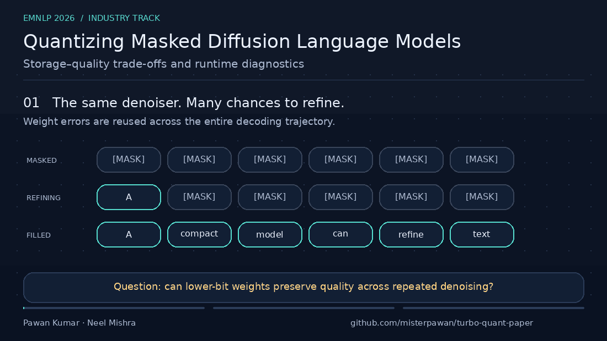

# Quantizing Masked Diffusion Language Models

**Storage–quality trade-offs and runtime diagnostics · EMNLP 2026 Industry Track**

A masked diffusion language model writes by revisiting its answer. The same denoiser sees a sequence of partially masked states, refining tokens over many steps. That makes compression an interesting question: when a small weight error is reused throughout decoding, can more computation repair the damage? And if a model takes less space on disk, does it actually need less GPU memory?

This paper studies those questions through post-training quantization, starting with LLaDA-8B-Instruct and checking how the picture changes across Dream-7B, MDLM-OWT, encoder-only masked LMs, LLaDA-MoE, and LLaDA2.0-mini. The motivation is practical: deployment decisions need separate measurements of predictive quality, serialized storage, and runtime memory. A nominal bit width cannot answer all three.

Our study finds three useful lessons. AWQ-4 is the closest tested quality-oriented 4-bit point at the evaluated resolution, with a detectable loss on ARC-Challenge. TurboLDM-(3+1), our stage-aware base-plus-residual reference, reaches a smaller serialized representation while sacrificing quality. NF4 reduces live VRAM in the tested PyTorch/bitsandbytes runtime. The sensitivity experiments also reveal that cheap individual attention projections can become damaging when quantized together, and extra denoising steps partly recover GSM8K loss while leaving multiple-choice accuracy largely unchanged.



[Read the paper](https://aclanthology.org/2026.emnlp-industry.241/) · [Reproduction guide](docs/REPRODUCIBILITY.md) · [Experiment map](docs/EXPERIMENTS.md) · [BibTeX](citation.bib)

This is the **code-only release for `emnlp-industry-2026-camera-ready`**. It contains the quantization library, experiment drivers, analysis scripts, and reproducibility documentation. Existing result logs, tables, model checkpoints, manuscript sources, and notebook outputs are excluded. Experiments download upstream models and datasets and generate their own outputs locally.

## What the paper establishes

- **Quality:** AWQ-4 is near BF16 at the tested 1.1–2.3 percentage-point resolution on several tasks; confidence intervals crossing zero do not establish equivalence. ARC-Challenge shows a detectable loss.
- **Storage:** TurboLDM-(3+1) reaches 4.82 GiB total serialized storage at 3.55 effective bits per quantized parameter, with lower quality. The effective-bit figure and total-model bytes have different denominators.
- **Runtime:** NF4 lowers peak inference VRAM from roughly 15 GiB to 6 GiB in the tested runtime. Other methods reconstruct floating-point weights in this reference implementation. Optimized AWQ/GPTQ kernels exist elsewhere; this observation is runtime-specific.
- **Diagnostics:** Joint attention quantization is more damaging than isolated projection experiments suggest. Additional steps help GSM8K more than multiple-choice tasks.

These are paper findings, not results newly generated by cloning this release. The GIF illustrates the workflow; its tokens are illustrative and its labels are not a benchmark plot.

## Install

The paper reports Linux, Python 3.12, one NVIDIA RTX 5090 with 32 GB VRAM, PyTorch 2.11, CUDA 13.0, and Transformers 4.55. This release was checked in an available Python 3.12 / PyTorch 2.11.0+cu128 / CUDA 12.8 environment. That differs from the paper's CUDA version; dependencies in `requirements.txt` are pinned to the available verification environment, not a recovered original lockfile.

```bash
git clone https://github.com/misterpawan/turbo-quant-paper.git
cd turbo-quant-paper
python3.12 -m venv .venv
source .venv/bin/activate
python -m pip install --upgrade pip
# CUDA 12.8 example; select a PyTorch build compatible with your driver.
python -m pip install torch==2.11.0 --index-url https://download.pytorch.org/whl/cu128
python -m pip install -r requirements.txt

export HF_HOME="$HOME/.cache/huggingface"
export HF_HUB_CACHE="$HF_HOME/hub"
export HF_DATASETS_CACHE="$HF_HOME/datasets"
export PYTORCH_CUDA_ALLOC_CONF=expandable_segments:True
# Set HF_TOKEN in your shell if an upstream model requires authentication.
python scripts/smoke_cpu.py
python scripts/capture_environment.py > environment.local.json
```

Use a writable cache with space for upstream 7B/8B/16B model downloads. A 32 GB CUDA GPU matches the main experimental setup; transfer and large-model diagnostics have their own memory constraints. The full study takes many GPU hours. Start with the CPU smoke check before launching models.

## Reproduce the main experiments

Run commands from the repository root, sequentially on one GPU:

```bash
# Main 8-method × 4-task × 3-seed quality grid: n=500 per task.
python codes/run_phase34.py

# NF4 reference (seed 42), then deterministic reruns (17 and 101).
python codes/run_phase47_nf4.py
python codes/run_phase51_nf4_seeds.py

# Full-model storage accounting; not a reusable checkpoint export.
python codes/run_phase21.py

# Corrected joint-family sensitivity and bits × steps diagnostics.
python codes/run_phase42_modsens_fix.py
python codes/run_phase83_bits_steps.py

# Paired-bootstrap main-table intervals from your new logs.
mkdir -p papers
python codes/bootstrap_ci.py \
  --in runs/overnight/phase34_main_ci_n500.jsonl \
  --out papers/gen_table_main_ci_n500.tex
```

The main quality grid uses seeds **42, 43, 44**, the first **500 examples per task** (MMLU, ARC-Challenge, HellaSwag, GSM8K), and a separate **24-text WikiText calibration set**. The main driver caps calibration at **192 tokens**, which is within the manuscript's stated maximum of 256. Multiple-choice decoding uses 16 steps, 8 generated tokens, block length 8, batch size 2; GSM8K uses 64 steps, 128 generated tokens, block length 32, batch size 1. See the [full guide](docs/REPRODUCIBILITY.md) for metrics, failures, resume behavior, transfer commands, and limitations.

Drivers append outputs under `runs/overnight/`; some skip completed cells when rerun. They may log failed cells and still exit successfully. Inspect `failures.jsonl` and validate completeness with:

```bash
python scripts/check_main_grid.py
```

## Code layout

| Path | Purpose |
|---|---|
| `codes/TurboLDM_experiments_helper.py` | Quantizers, model registry, calibration, stage-aware residual scheduling, sampler, evaluation |
| `codes/run_phase*.py` | Main and appendix experiments; historical phase numbers preserve traceability |
| `codes/run_overnight.py`, `codes/run_extensions.py` | Shared utilities and earlier grids used in appendix comparisons |
| `codes/bootstrap_ci.py` | Paired-bootstrap analysis of per-example correctness |
| `codes/render*.py`, `codes/aggregate_and_render.py` | Regenerate analyses from newly produced logs |
| `scripts/` | CPU smoke check, environment capture, grid validation, overview GIF generator |
| `docs/EXPERIMENTS.md` | Claim-to-driver map and auxiliary experiments |
| `docs/source-manifest.json` | Source and released code hashes |

The code includes reference implementations of AWQ-style activation scaling, diagonal/full-Hessian GPTQ variants, and Q-Diffusion-Text adaptation. Method names should be read with those implementation details; this release does not require AutoAWQ or AutoGPTQ. NF4 explicitly uses bitsandbytes `Linear4bit`. Experimental fused-kernel prototypes outside the camera-ready study are excluded.

## Animation

The 18-second overview loops without audio. To regenerate it:

```bash
python -m pip install Pillow==12.2.0
python scripts/make_overview_gif.py
```

The generator uses Pillow and a DejaVu Sans font, with no external image service or model download. It also writes a static overview PNG for accessibility and inspection.

## Authors and citation

Paper authors: **Pawan Kumar and Neel Mishra**. Repository maintainer: **Pawan Kumar** ([misterpawan](https://github.com/misterpawan)).

**Affiliation:** IIIT, Hyderabad, India

**Contact:** [pk.iiith@gmal.com](mailto:pk.iiith@gmal.com)

**Research Lab:** [optimalstar.org](https://optimalstar.org)

**Product Lab:** [aiwranglers.org](https://aiwranglers.org)

Please cite [citation.bib](citation.bib):

```bibtex
@inproceedings{kumar-mishra-2026-quantizing,
  title = {Quantizing Masked Diffusion Language Models: Storage-Quality Trade-offs and Runtime Diagnostics},
  author = {Kumar, Pawan and Mishra, Neel},
  booktitle = {Proceedings of the 2026 Conference on Empirical Methods in Natural Language Processing: Industry Track},
  year = {2026},
  publisher = {Association for Computational Linguistics},
  url = {https://aclanthology.org/2026.emnlp-industry.241/},
  pages = {4067--4089}
}
```

Code is released under [Apache-2.0](LICENSE). Upstream models and datasets retain their respective licenses.
